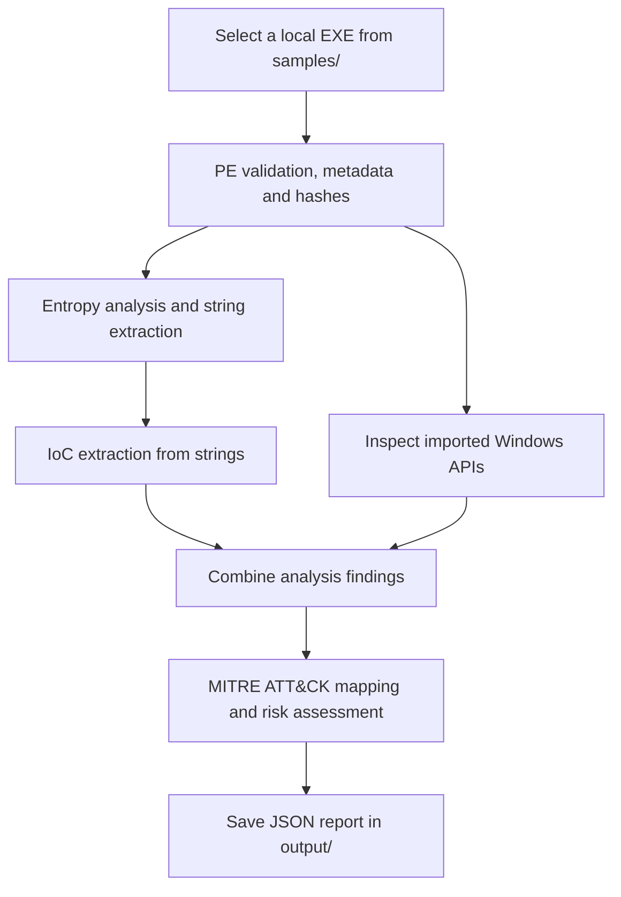

# MalTrace

**Static Binary Analyzer + MITRE ATT&CK Mapper**

MalTrace is a Python-based educational tool for performing **static analysis of Windows Portable Executable (PE) files**. It examines file structure, hashes, strings, entropy, indicators of compromise (IoCs), and imported Windows APIs. Selected findings are mapped to relevant MITRE ATT&CK techniques and can be used to produce an explainable risk assessment.

> **Important:** MalTrace reads files for static inspection. It is not a sandbox, antivirus product, or proof that a file is safe or malicious.

## Table of Contents

- [Features](#features)
- [Attack Category and MITRE ATT&CK Mapping](#attack-category-and-mitre-attck-mapping)
- [Analysis Workflow](#analysis-workflow)
- [Project Structure](#project-structure)
- [Installation](#installation)
- [Usage](#usage)
- [Understanding the Results](#understanding-the-results)
- [Ethical Considerations](#ethical-considerations)
- [Rules of Engagement (RoE)](#rules-of-engagement-roe)
- [Responsible Disclosure](#responsible-disclosure)
- [Legal Disclaimer](#legal-disclaimer)
- [Limitations](#limitations)

## Features

| Module | Purpose |
|---|---|
| `pe_analyzer.py` | Validates and inspects PE files; extracts file hashes, headers, architecture, sections, imports, and structural flags. |
| `string_analyzer.py` | Calculates Shannon entropy, extracts ASCII and UTF-16LE strings, and identifies high-entropy byte regions. |
| `entropy_context.py` | Relates high-entropy regions to PE sections and classifies them as benign, review, suspicious, or unknown. |
| `ioc_extractor.py` | Extracts indicators such as IP addresses, URLs, domains, and file hashes from strings. |
| `mitre_mapper.py` | Detects selected suspicious Windows API imports and string references, then maps findings to possible ATT&CK techniques and attack patterns. |
| `riskscorer.py` | Combines behavioural, PE/packing, string, network, and cross-module signals into an explainable score from 0 to 100. |
| `main.py` | Provides the command-line workflow and saves analysis results as a JSON report. |

The `riskscorer.py` and `entropy_context.py` modules provide supporting analysis functions. **In the current public `main.py`, these two modules are not yet called by the main scan workflow.** Their results should only be described as part of the end-to-end output after they have been integrated and tested with the PE section data.

## Attack Category and MITRE ATT&CK Lifecycle Mapping

MalTrace focuses on **static indicators associated with Windows malware techniques**. It maps selected imported APIs and extracted strings to relevant MITRE ATT&CK Enterprise tactics and techniques.

| Lifecycle area | What MalTrace looks for | Example ATT&CK references |
|---|---|---|
| Execution | Process creation and command-execution-related APIs | Native API (T1106); Command and Scripting Interpreter (T1059) |
| Persistence | Registry and Windows service-related APIs | Registry Run Keys / Startup Folder (T1547.001); Windows Service (T1543.003) |
| Defense Evasion | Process injection, process hollowing, dynamic API resolution, and debugger-evasion indicators | Process Injection (T1055); Process Hollowing (T1055.012); Debugger Evasion (T1622); Dynamic API Resolution (T1027.007) |
| Discovery | Process and system-information discovery APIs | Process Discovery (T1057); System Information Discovery (T1082) |
| Credential Access / Collection | Credential-store and keyboard-monitoring API indicators | Credentials from Password Stores (T1555); Keylogging (T1056.001) |
| Command and Control / Transfer | Network communication and remote payload-transfer APIs | Application Layer Protocol (T1071); Ingress Tool Transfer (T1105) |

This is a **partial static-analysis mapping**, not a complete attack lifecycle detector. The current rules do not establish Initial Access, observe runtime actions, or prove that a mapped technique was performed. A detected API or string is only an indicator. Review mappings against the official [MITRE ATT&CK website](https://attack.mitre.org/).

## Analysis Workflow



The workflow describes the intended analysis pipeline. The contextual entropy and combined risk-scoring helpers are currently separate from `main.py` and require integration before their results appear in the normal scan report.

## Project Structure

```text
MalTrace/
├── main.py
├── guardrails.py
├── inspect_report.py
├── README.md
├── modules/
│   ├── pe_analyzer.py
│   ├── string_analyzer.py
│   ├── entropy_context.py
│   ├── ioc_extractor.py
│   ├── mitre_mapper.py
│   └── riskscorer.py
├── samples/
│   └── README.md
└── output/
```

`output/` is used for generated reports. `guardrails.py` contains supporting safety helpers, but the current `main.py` does not call them as part of its scan flow. Keep executable samples and generated reports out of the public repository unless you have verified that they are safe and appropriate to publish.

## Installation

### Requirements

- Windows (the current workflow analyses Windows PE/EXE files)
- Python 3
- `pefile`

### Setup

1. Clone the repository:

   ```bash
   git clone https://github.com/Rydersnake/MalTrace.git
   ```

2. Enter the project directory:

   ```bash
   cd MalTrace
   ```

3. Install the required PE parsing library:

   ```bash
   python -m pip install pefile
   ```

4. Place a **benign, authorised test `.exe` file** in the local `samples/` directory. Do not commit executable samples to the public repository.

## Usage

Run the command-line tool from the project root:

```bash
python main.py
```

MalTrace lists `.exe` files found in `samples/`. Select a file by entering its displayed number. The current main workflow performs PE analysis, string/entropy analysis, IoC extraction, and MITRE API analysis, then writes a JSON report to `output/`.

Example output structure:

```text
MalTrace/
├── samples/
│   └── example.exe          # local test file; do not publish
└── output/
    └── example_report.json  # generated report
```

The exact findings depend on the selected executable. A clean or low-indicator result does not prove that a file is safe.

## Understanding the Results

- **Hashes:** MD5, SHA-1, and SHA-256 identifiers for the analysed file.
- **PE information:** File architecture, headers, sections, imports, and structural flags.
- **Entropy:** A statistical measure of byte distribution. High entropy may be caused by packing, compression, encryption, or legitimate embedded resources.
- **Strings and IoCs:** Readable text and possible network or file indicators extracted from the binary.
- **MITRE findings:** Possible ATT&CK technique associations inferred from selected API imports and strings.
- **Risk score:** An explainable heuristic estimate from several evidence categories. It is not a malware probability or a definitive verdict.

## Ethical Considerations

MalTrace is intended for cybersecurity education, authorised defensive analysis, and controlled laboratory use. Users must:

- Analyse only files they own or are explicitly authorised to examine.
- Use benign test files for routine development and demonstrations.
- Keep suspicious samples in an isolated, access-controlled analysis environment.
- Never execute an unknown sample on a normal workstation as part of this static-analysis workflow.
- Protect confidential files, personal data, and any extracted indicators.
- Avoid publishing live malware, private data, credentials, or sensitive findings in this public repository.

## Rules of Engagement (RoE)

Before an assessment, define and follow these rules:

1. **Authorisation:** Obtain written permission from the file owner or responsible organisation.
2. **Scope:** Limit analysis to the specific files and systems approved for the assessment.
3. **Method:** Use static inspection only. Do not execute samples, establish network connections, alter target systems, or attempt persistence.
4. **Environment:** Store potentially harmful files in a controlled, isolated location with restricted access.
5. **Data handling:** Record hashes and findings securely; do not redistribute samples or confidential information without permission.
6. **Stop condition:** Stop analysis if the file is outside the approved scope, the environment becomes unsafe, or authorisation is withdrawn.
7. **Reporting:** Document evidence, uncertainty, false-positive possibilities, and the limits of the analysis.

## Responsible Disclosure

If analysis reveals a previously unknown vulnerability or security issue:

1. Do not exploit it beyond what is necessary to validate the finding within the authorised scope.
2. Preserve relevant evidence without exposing personal or confidential information.
3. Report the issue privately to the affected vendor, owner, or designated security contact.
4. Provide a clear description, affected component, impact, reproducible evidence where safe, and suggested mitigation.
5. Allow the recipient reasonable time to investigate and address the issue before public disclosure.

## Legal Disclaimer

MalTrace is provided for educational and authorised defensive security purposes only. Users are responsible for ensuring that their use complies with applicable laws, regulations, institutional policies, and the terms governing the files they analyse, including relevant Malaysian cybercrime laws such as the **Computer Crimes Act 1997**. The project authors do not authorise unauthorised access, malware deployment, disruption, or unlawful handling of data. This README is not legal advice.

## Limitations

- MalTrace performs static analysis; it does not observe runtime behaviour or execute files in a sandbox.
- API imports and strings can be present in legitimate software and may produce false positives.
- Dynamically resolved, encrypted, obfuscated, or packed behaviour may not be visible to static inspection.
- Entropy alone cannot distinguish malicious packing from legitimate compression or resources.
- IoC extraction is pattern-based and may miss indicators or identify false positives.
- MITRE ATT&CK mappings are heuristic associations, not proof that a technique was performed.
- Risk scores are rule-based estimates and must be interpreted with the evidence and notes, not as a malware probability.
- `entropy_context.py` and `riskscorer.py` are present as supporting modules, but their results are not yet included in the current `main.py` scan output. The PE section data must also include raw file offsets for entropy regions to be mapped to sections correctly.
- `guardrails.py` is present, but its helper controls are not currently invoked by `main.py`; users must follow the Rules of Engagement in this README independently.

---

**Project:** MalTrace — Static Binary Analyzer + MITRE ATT&CK Mapper  
