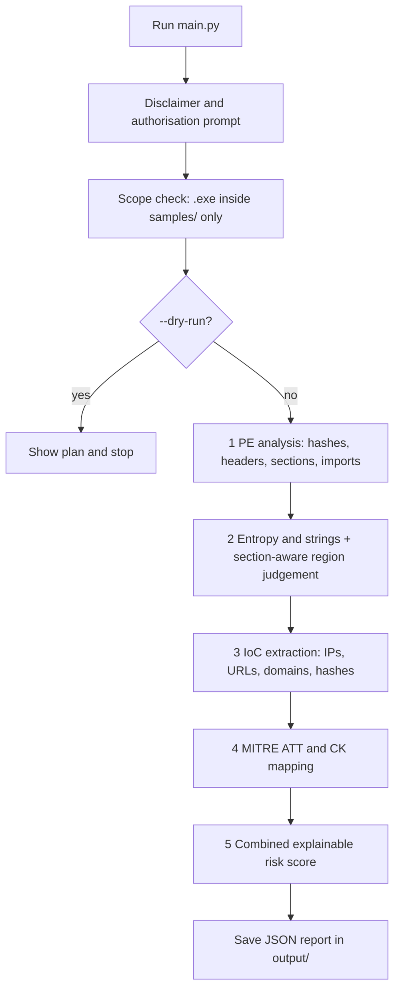

# MalTrace

**Static Binary Analyzer & MITRE ATT&CK Mapper**

MalTrace is a Python command-line tool for the static inspection of Windows Portable Executable (PE) files. It collects file hashes and PE metadata, analyses entropy by PE section, extracts readable strings and indicators of compromise (IoCs), maps selected Windows API indicators to MITRE ATT&CK techniques, and combines everything into one **explainable risk score** saved in a JSON report.

MalTrace is an educational defensive-security project built for the IKB31603 Ethical Hacking course (UniKL MIIT). It reads files as data and **never executes samples**. Its findings are indicators for further investigation, not proof that a file is malicious or safe.

> **Safety first:** Analyse only files you own or are explicitly authorised to examine. Do not run unknown samples. Keep samples and reports private; never upload real malware or sensitive investigation material to this public repository.

## Table of contents

1. [At a glance](#at-a-glance)
2. [Attack category and scope](#attack-category-and-scope)
3. [Features](#features)
4. [Analysis workflow](#analysis-workflow)
5. [Attack lifecycle mapping](#attack-lifecycle-mapping)
6. [Combined risk score](#combined-risk-score)
7. [Installation](#installation)
8. [Usage](#usage)
9. [Example output](#example-output)
10. [Testing and calibration](#testing-and-calibration)
11. [Understanding results](#understanding-results)
12. [Ethical considerations](#ethical-considerations)
13. [Rules of Engagement (RoE)](#rules-of-engagement-roe)
14. [Responsible disclosure](#responsible-disclosure)
15. [Legal disclaimer](#legal-disclaimer)
16. [Limitations](#limitations)
17. [Repository structure](#repository-structure)
18. [Troubleshooting](#troubleshooting)
19. [Development notes](#development-notes)
20. [Contributors, license and references](#contributors-license-and-references)

## At a glance

| Item | Details |
|---|---|
| Tool | MalTrace |
| Category | Malware (static malware analyzer, PE inspector, IoC extractor) |
| Input | Windows `.exe` files inside the local `samples/` folder |
| Entry point | `main.py` (command-line interface) |
| Output | JSON report in `output/` |
| Language / dependency | Python 3.9+ and `pefile` |
| Mode | Static analysis only; samples are never executed; no network connections |

## Attack category and scope

**Category: Malware analysis.** MalTrace supports introductory static analysis of Windows malware-related artefacts. It looks for static clues associated with:

- Process injection and process hollowing
- Registry and service-related persistence
- Debugger evasion and dynamic API resolution
- Process and system discovery
- Credential-access and input-capture indicators
- Network communication and tool-transfer indicators
- Packed or obfuscated code (high-entropy regions, odd PE structure)

MalTrace does **not** execute malware, monitor runtime behaviour, capture network traffic, query reputation services, or replace a sandbox or incident-response process.

## Features

| Module | Main functions |
|---|---|
| `main.py` | Command-line interface (`argparse`), ethical gate, analysis pipeline, JSON report with metadata |
| `guardrails.py` | Legal disclaimer and authorisation prompt, scope check (only `.exe` files inside `samples/`), output-folder restriction, dry-run support, kill switch (Ctrl+C) |
| `modules/pe_analyzer.py` | MD5/SHA-1/SHA-256; PE headers, sections (with permissions and entropy), imports; heuristic PE flags (writable+executable section, UPX name, entry point outside code, few imports) |
| `modules/string_analyzer.py` | Shannon entropy; ASCII and UTF-16LE string extraction; high-entropy regions; selected suspicious strings; 100 MB input limit |
| `modules/entropy_context.py` | Maps each high-entropy region to the PE section that contains it and judges it (benign in `.rsrc`/`.reloc`, review in data sections or overlay, suspicious inside executable sections); produces a context-aware verdict |
| `modules/ioc_extractor.py` | Validated IPv4 addresses, URLs, domains (real TLDs only) and hash-shaped strings; well-known vendor domains and URLs are **reported separately** as trusted instead of being hidden |
| `modules/mitre_mapper.py` | Matches selected API names from imports and strings; groups findings by ATT&CK tactic; evaluates attack chains (API combinations); behaviour-only score |
| `modules/risk_scorer.py` | Combines all modules into one capped, explainable score with a reason for every point |
| `calibrate.py` | Runs the analysis on every sample and builds a comparison table (`output/calibration.csv` and `.md`) |
| `inspect_report.py` | Local helper to inspect a saved JSON report |

## Analysis workflow



## Attack lifecycle mapping

MalTrace is a **defensive analysis** tool. It sits in the analysis stages of the ethical hacking lifecycle and does not attack anything.

| Lifecycle stage | MalTrace role |
|---|---|
| Reconnaissance / information gathering | Collects hashes, PE metadata, sections, imports, strings and IoCs from the sample |
| Analysis / vulnerability assessment | Judges entropy by section, detects suspicious APIs and attack chains |
| Threat modelling | Maps findings to MITRE ATT&CK tactics and techniques and produces a risk score |
| Reporting | Saves a structured JSON report with metadata and the full score breakdown |

### MITRE ATT&CK mapping

The mapper uses a **selected local subset** of MITRE ATT&CK Enterprise techniques. Coverage is not comprehensive.

| Tactic / behaviour area | Example techniques | Static evidence considered |
|---|---|---|
| Execution | Native API (`T1106`); Command and Scripting Interpreter (`T1059`) | Selected process-creation or execution-related API indicators |
| Persistence | Registry Run Keys / Startup Folder (`T1547.001`); Windows Service (`T1543.003`) | Selected registry- and service-related indicators |
| Defense Evasion | Process Injection (`T1055`); Process Hollowing (`T1055.012`); Debugger Evasion (`T1622`) | Memory-manipulation and debugger-check API indicators |
| Stealth / dynamic API resolution | Dynamic API Resolution (`T1027.007`) | `LoadLibrary` and `GetProcAddress`-style indicators |
| Credential Access / Collection | Credentials from Password Stores (`T1555`); Keylogging (`T1056.001`) | Selected credential and keyboard-hook API indicators |
| Discovery | Process Discovery (`T1057`); System Information Discovery (`T1082`) | Process-enumeration and system-information API indicators |
| Command and Control / transfer | Web Protocols (`T1071.001`); Ingress Tool Transfer (`T1105`) | Selected networking and download API indicators |

ATT&CK matches are hypotheses based on static indicators. An imported API does not prove it was called, and an API combination does not prove a behaviour occurred in sequence. Verify technique IDs against the [MITRE ATT&CK knowledge base](https://attack.mitre.org/) before relying on them in a formal assessment.

## Combined risk score

A single suspicious API is common in normal software, so it is worth few points. Signals that **agree across independent modules** are worth more. Each category has a cap, so one noisy module cannot push the score to 100 alone, and every point is listed with its reason.

| Category | Cap | What it counts |
|---|---|---|
| Behaviour (MITRE) | 50 | Suspicious APIs (high 3, medium 1, low 0; at most 10 in total) plus attack chains by their bonus. The two very common chains (*Dynamic API Obfuscation*, *Registry Persistence*) count at 25% |
| Packing and PE structure | 30 | High-entropy region inside an executable section +10 each (max 20); in data section or overlay +1 each (max 3); PE flags by severity (high 8, medium 4, low 1). Plain "high entropy" PE flags are not counted again, because regions are judged by section |
| String clues | 15 | Packer or protector names (UPX, Themida, ...) +8; system tools (`rundll32`, `powershell`, ...) +2 each (max 6). Matching uses word boundaries. Registry root names (`HKEY_*`) score 0 |
| Unknown network indicators | 15 | IP address +3; unknown domain +2. Trusted vendor domains score 0 |
| Signals that agree across modules | 25 | Packed or odd PE structure **and** runtime API resolution +15; process injection **and** unknown network indicators +10 |

The total is capped at 100. Levels: **LOW** below 35, **MEDIUM** 35 to 69, **HIGH** 70 or more, **NONE** for 0.

> The weights and thresholds are design decisions based on reasoning and a small set of tests. They are heuristics, not a validated or statistically calibrated model.

## Installation

**Requirements:** Windows, Python 3.9 or newer, Git (or a ZIP download).

```powershell
git clone https://github.com/Rydersnake/MalTrace.git
cd MalTrace
py -m venv venv
venv\Scripts\activate
py -m pip install -r requirements.txt
```

If `py` is unavailable, use `python` instead. Then place an authorised, benign Windows `.exe` in the local `samples/` folder. **Do not commit it**: `samples/` and `output/` are excluded by `.gitignore`.

## Usage

Run from the project root:

```powershell
py main.py --help
py main.py --list
py main.py --file samples\sample.exe
py main.py --file samples\sample.exe --dry-run
py main.py --file samples\sample.exe --output output
py main.py                      # interactive menu
```

| Flag | Description |
|---|---|
| `--file FILE` | File to analyse (must be an `.exe` inside `samples/`) |
| `--list` | List the files available in `samples/` |
| `--output DIR` | Report folder, must stay inside the project (default `output`) |
| `--dry-run` | Check scope and show what would happen, without analysing or writing anything |
| `--confirm-authorized` | Confirm authorisation without the typed prompt (for automation only; the disclaimer is still shown) |

Exit codes: `0` success, `1` failure or refusal, `130` aborted with Ctrl+C.

To run the analysis on every sample and compare scores:

```powershell
py calibrate.py
```

The report for each file is saved as `output/<name>_report.json` and contains `metadata`, `pe_analysis`, `string_analysis`, `ioc_analysis`, `mitre_analysis` and `risk_assessment` sections.

## Example output

Real output from analysing `taskmgr.exe` copied from the author's own Windows installation (banner and disclaimer omitted):

```text
[2] ENTROPY AND STRING ANALYSIS
Entropy: 6.11
Verdict (global): normal
Packed regions: 2 {'benign': 0, 'review': 2, 'suspicious': 0, 'unknown': 0}
Verdict (context): review - high-entropy data outside code (2 region(s))
Suspicious strings: 2
Strings extracted: 57103

[3] IOC EXTRACTION
ips: 0 found
urls: 0 found
trusted_urls: 3 found
domains: 1 found
trusted_domains: 4 found
hashes: 0 found

[4] MITRE ATT&CK ANALYSIS
Suspicious APIs: 10
MITRE Risk Score (behaviour only): 25 /100
MITRE Risk Level (behaviour only): LOW

[5] COMBINED RISK ASSESSMENT
Combined Risk Score: 17 /100
Combined Risk Level: LOW
  Behaviour (MITRE APIs and attack chains): 11/50
      +7   10 suspicious API(s) found, 1 high severity (single APIs are weak evidence)
      +2   Chain 'Dynamic API Obfuscation' (common in normal software, reduced weight)
      +2   Chain 'Registry Persistence' (common in normal software, reduced weight)
  Packing and PE structure: 2/30
      +2   2 high-entropy region(s) in data sections or overlay
  String clues (packers, system tools): 2/15
      +2   System tool name(s) found: cmd (also used by legitimate software)
  Unknown network indicators: 2/15
      +2   1 unknown domain(s) in strings
  Signals that agree across modules: 0/25
```

### Screenshots

| Screenshot | Shows |
|---|---|
|  | `--help` with usage examples |
|  | Disclaimer, authorisation prompt and `--dry-run` |
|  | Full analysis, steps 1 to 5 |
|  | A file outside `samples/` is refused |
|  | An output folder outside the project is refused |
|  | Ctrl+C aborts cleanly |
|  | `calibrate.py` comparison table |

## Testing and calibration

### Calibration on legitimate Windows programs

`calibrate.py` was run on four legitimate programs copied from the author's own Windows installation:

| File | MITRE only | Combined | Level | Suspicious regions | Review regions | Unknown IoCs |
|---|---|---|---|---|---|---|
| explorer.exe | 34 | 18 | LOW | 0 | 2 | 0 |
| taskmgr.exe | 25 | 17 | LOW | 0 | 2 | 1 |
| cmd.exe | 26 | 14 | LOW | 0 | 0 | 0 |
| notepad.exe | 12 | 7 | LOW | 0 | 1 | 0 |

All four score LOW, and the combined score is lower than the behaviour-only score for every file. Scores depend on the exact Windows version of each file.

### What changed during development (`explorer.exe`)

| Measure | First version | Current version |
|---|---|---|
| MITRE risk score | 100 / HIGH (every API added points, no caps) | 34 / LOW with caps and chain weighting |
| Combined score | n/a | 18 / LOW |
| Domains reported as unknown | 747 (file names, DLL names and version numbers counted as domains) | 0, with 8 vendor domains listed separately as trusted |
| High-entropy regions | 6 regions, all looked suspicious | 4 benign (`.rsrc`), 2 to review (`.rdata`, overlay) |
| Suspicious strings | 9, seven of them plain `HKEY_*` registry names | `HKEY_*` no longer scored |

### Honest scope of testing

- Only legitimate files were tested. These results show **no false alarms on those files**; they do **not** prove that real malware is detected.
- The scoring logic was exercised with synthetic inputs (an injector with a network indicator, a packer stub, empty inputs), but not with real malware.
- There is no automated test suite yet.

## Understanding results

- **Hashes** identify exact file contents; they do not say whether a file is malicious.
- **Entropy** can indicate compression, encryption or packing, but legitimate files have high-entropy resources too. That is why regions are judged by the section they fall in.
- **IoCs** are extracted candidates and may include false positives or benign values.
- **API matches** show that an API name was imported or found in strings, not that it executed.
- **The score and level** are heuristic outputs from local rules, not a malware probability.

A low score does not prove a file is safe, and a high score does not prove it is malicious. Review the evidence in the `risk_assessment` section of the report and corroborate with trusted sources.

## Ethical considerations

1. **Authorisation.** On every start MalTrace shows a legal disclaimer citing the Computer Crimes Act 1997 and requires you to type `yes` to confirm you are authorised (or pass `--confirm-authorized`, which still displays the disclaimer).
2. **Scope enforcement.** Only `.exe` files inside `samples/` are accepted. Paths are resolved to absolute paths, so `..` tricks cannot escape the folder.
3. **Safe defaults.** The default scope is the local `samples/` folder and the default output folder is `output/`. MalTrace makes no network connections and does not scan any host.
4. **Dry run.** `--dry-run` checks scope and shows what would be analysed and where the report would go, without reading the sample or writing a report.
5. **Kill switch.** Ctrl+C aborts cleanly at any point, including at the authorisation prompt, with exit code 130.
6. **Data handling.** Reports are written only to a folder inside the project and are labelled with a `metadata` block (tool, version, UTC time, "static analysis only", scope). Nothing is uploaded. Reports contain extracted strings, which may include sensitive text from the sample, so keep `output/` private. It is excluded by `.gitignore`.
7. **Accurate reporting.** Results are described as indicators that need validation, not as verdicts.

## Rules of Engagement (RoE)

Agree and document the following before any analysis.

**Authorised scope**
- Only files you own, or have explicit written permission to analyse, placed in the local `samples/` folder.
- No network, website, cloud or third-party infrastructure is in scope. Extracted IoCs must not be used to probe third-party systems.

**Time windows**
- Analysis takes place only during the agreed assessment period (for coursework: lab sessions and the assignment period set by the lecturer).
- For any non-coursework use, agree the start and end time with the file owner in writing, and do not analyse outside that window.

**Permitted techniques**
- Reading the file; calculating hashes and entropy; extracting strings and candidate IoCs; inspecting PE headers, sections and imports; applying the local ATT&CK rules; saving a local JSON report.
- Analysing known-benign files, and malware samples **only inside an isolated virtual machine with networking disabled**, and only with permission.

**Prohibited actions**
- Executing, detonating or distributing any analysed sample.
- Analysing files without authorisation.
- Using extracted indicators to attack, scan or contact third-party systems.
- Collecting credentials, or publishing personal data, private infrastructure details or confidential findings.
- Modifying the tool to bypass the scope check, authorisation prompt or output restriction.
- Committing samples or reports to this public repository.

**Emergency stop procedures**
1. Press **Ctrl+C**. MalTrace aborts cleanly.
2. If authorisation is unclear or withdrawn, the sample is out of scope, or sensitive information is exposed: stop, close the terminal and do not save or share the report.
3. If a sample may have been executed or the environment behaves unexpectedly: disconnect the VM's network, power the VM off, revert to a clean snapshot, and notify the lecturer or the owner's security contact.

**Evidence handling**
- Keep the original sample unchanged; record its SHA-256 hash and store reports in approved private storage.

## Responsible disclosure

**If you find a vulnerability in MalTrace itself**
- *Who:* the repository maintainers. Use a private GitHub security advisory on this repository, or contact `<maintainer contact>`.
- *When:* report as soon as you find it. We aim to acknowledge within 7 days and ask that you allow 90 days for a fix before any public disclosure.
- *How:* describe the problem, steps to reproduce, the affected version and the impact. Do not publish exploit details before a fix is released.

**If an analysis suggests a concern about a real organisation, product or system**
- *Who:* the organisation's security contact or its vendor security team. If there is no contact, a national CERT (in Malaysia, MyCERT / Cyber999; verify the current contact details first).
- *When:* promptly, and before sharing any indicator publicly.
- *How:* report privately. Share only the minimum evidence (sample SHA-256 and relevant static findings). Do not access or test the suspected system based only on an extracted indicator, and do not publish personal data, credentials, private infrastructure details or unverified allegations. Follow the recipient's coordinated disclosure process.

MalTrace does not submit findings to any external service. Disclosure is a human-led process.

## Legal disclaimer

MalTrace is provided for **education and authorised defensive-security work only**. Unauthorised access to, or modification of, computer material is an offence under the **Computer Crimes Act 1997 (Akta Kesalahan Komputer 1997)** of Malaysia. Users are responsible for complying with all applicable laws, regulations, institutional policies, contracts and permission requirements, and for obtaining authorisation before analysing any file. Nothing in this README is legal advice. The software and its findings are provided "as is", without any guarantee of accuracy, completeness or fitness for a particular decision. The authors accept no liability for misuse.

## Limitations

- Windows `.exe` PE files only. No DLL, ELF, Mach-O, script or document support.
- Static analysis cannot observe runtime behaviour, memory, network traffic or whether an API is actually called. Packed, encrypted or obfuscated samples can hide imports and strings.
- Scoring weights and thresholds are heuristics and have not been statistically validated. Testing covered four legitimate Windows programs and synthetic inputs; **no real malware was tested**, so detection ability is unproven.
- ATT&CK coverage is limited to the techniques in the local rule database.
- API, string, entropy and IoC heuristics produce false positives and false negatives. For example, a four-number version string whose values are all valid octets can still be reported as an IP address, and the list of valid TLDs is limited.
- The trusted-domain list is an assumption. Attackers can abuse trusted infrastructure, which is why trusted items are reported separately rather than discarded.
- High-entropy data after the last section (overlay) is marked for review. It is not automatically verified as a digital signature.
- Only IPv4 addresses are extracted.
- JSON reports store all extracted strings and can be large.
- The string analyser refuses files larger than 100 MB.
- No reputation lookups or threat-intelligence feeds are used.
- No automated test suite yet.

## Repository structure

```text
MalTrace/
├── main.py                 # CLI, ethical gate, analysis pipeline, JSON report
├── guardrails.py           # Disclaimer, scope check, output restriction, kill switch
├── calibrate.py            # Compare scores across all samples
├── inspect_report.py       # Local JSON report inspection helper
├── requirements.txt
├── LICENSE
├── README.md
├── .gitignore
├── docs/                   # Screenshots used in this README
├── modules/
│   ├── __init__.py
│   ├── pe_analyzer.py
│   ├── string_analyzer.py
│   ├── entropy_context.py
│   ├── ioc_extractor.py
│   ├── mitre_mapper.py
│   └── risk_scorer.py
├── samples/                # Authorised test EXEs, local only (not committed)
└── output/                 # Generated reports, local only (not committed)
```

## Troubleshooting

| Problem | Suggested action |
|---|---|
| `ModuleNotFoundError: pefile` | Run `py -m pip install -r requirements.txt`. |
| `ModuleNotFoundError: guardrails` or `modules...` | Run from the project root; make sure `guardrails.py` is next to `main.py` and `modules/` has `__init__.py`. |
| No EXE files found | Confirm `samples/` contains an authorised `.exe`. |
| `[!] Out of scope` | The file is outside `samples/`. Copy it there (only if you are authorised). |
| `[!] Output directory not allowed` | Choose an `--output` folder inside the project. |
| `Not a valid PE file` | The file is not a supported Windows executable, or it is damaged. |
| Note: "No attack-chain data found" in the score | `mitre_mapper.py` returned no chain list; check its result keys. |

## Development notes

- **AI assistance:** `<state honestly how AI tools were used, for example for debugging, comments, documentation and short snippets, and who reviewed and understands the code>`.
- **Team roles:** `<list who wrote which module>`.
- **Future improvements:** automated tests; recognise the Authenticode signature automatically; categorise suspicious strings; limit how many strings are saved in reports; calibrate weights on a larger and more varied set of files; DLL support; HTML/PDF reports.

## Contributors, license and references

**Contributors:** `<Name 1>`, `<Name 2>`, `<Name 3>`, `<Name 4>`

**License:** MIT, see [LICENSE](LICENSE).

**References**
- [MalTrace repository](https://github.com/Rydersnake/MalTrace)
- [MITRE ATT&CK Enterprise](https://attack.mitre.org/)
- [pefile on PyPI](https://pypi.org/project/pefile/)
- [Python documentation](https://docs.python.org/3/)

---

**Project status:** academic prototype for the IKB31603 Ethical Hacking course. Review the code and test the rules further before using it beyond a controlled educational exercise.
