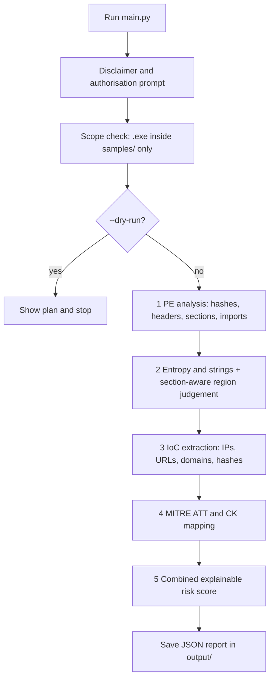

# MalTrace

**Static Binary Analyzer & MITRE ATT&CK Mapper**

MalTrace is a Python command-line tool for static analysis of Windows Portable Executable (PE) files. It collects file hashes and PE metadata, analyses entropy and readable strings, extracts indicators of compromise (IoCs), maps selected Windows API indicators to MITRE ATT&CK, and produces an explainable risk assessment in a JSON report.

MalTrace is an educational defensive-security project for the IKB31603 Ethical Hacking course at UniKL MIIT. It reads files as data and **does not execute samples**. Its findings are indicators for investigation, not proof that a file is malicious or safe.

> **Safety first:** Analyse only files you own or are explicitly authorised to examine. Do not execute unknown samples. Keep samples and reports private; never upload real malware or sensitive investigation material to this public repository.

## Contents

- [Overview and attack category](#overview-and-attack-category)
- [Features and workflow](#features-and-workflow)
- [Attack lifecycle and MITRE ATTCK mapping](#attack-lifecycle-and-mitre-attck-mapping)
- [Risk scoring](#risk-scoring)
- [Installation and usage](#installation-and-usage)
- [Calibration results](#calibration-results)
- [Understanding results and limitations](#understanding-results-and-limitations)
- [Ethical considerations and Rules of Engagement](#ethical-considerations-and-rules-of-engagement)
- [Responsible disclosure](#responsible-disclosure)
- [Legal disclaimer](#legal-disclaimer)
- [Repository structure](#repository-structure)
- [References and contributors](#references-and-contributors)

## Overview and attack category

| Item | Details |
|---|---|
| Tool | MalTrace |
| Category | Malware analysis / static PE analysis / IoC extraction |
| Input | Authorised Windows `.exe` files in the local `samples/` folder |
| Entry point | `main.py` |
| Output | JSON reports in `output/` |
| Requirements | Windows, Python 3.9+, and `pefile` |
| Operation | Static analysis only; no sample execution or network connection |

MalTrace examines static indicators associated with process injection, process hollowing, registry or service persistence, debugger evasion, dynamic API resolution, discovery, credential-access indicators, network-related APIs, and potentially packed or obfuscated code.

It does not perform dynamic analysis, monitor runtime behaviour, capture network traffic, query online reputation services, or replace a malware sandbox or incident-response process.

## Features and workflow

| Component | Purpose |
|---|---|
| `main.py` and `guardrails.py` | CLI, authorisation prompt, scope and output checks, dry-run option, Ctrl+C stop, and JSON report generation |
| `modules/pe_analyzer.py` | PE validation, file hashes, headers, sections, permissions, imports, and structural flags |
| `modules/string_analyzer.py` | Shannon entropy, ASCII/UTF-16LE strings, high-entropy regions, and selected suspicious strings |
| `modules/entropy_context.py` | Relates high-entropy regions to PE sections and classifies them for review |
| `modules/ioc_extractor.py` | Extracts IPv4 addresses, URLs, domains, and hash-shaped strings; separates recognised vendor indicators as trusted |
| `modules/mitre_mapper.py` | Detects selected API indicators, groups ATT&CK techniques, evaluates API combinations, and calculates a behaviour-only score |
| `modules/risk_scorer.py` | Combines evidence from analysis modules into a capped, explainable risk score |
| `calibrate.py` | Analyses available samples and creates comparison files in `output/` |
| `inspect_report.py` | Local helper for viewing saved JSON report details |

### Analysis workflow



## Attack lifecycle and MITRE ATT&CK mapping

MalTrace is a **defensive analysis and reporting tool**. It does not conduct an attack. Its role in an ethical hacking workflow is:

| Lifecycle stage | MalTrace activity |
|---|---|
| Information gathering | Collects hashes, PE metadata, sections, imports, strings, and IoCs from an authorised sample |
| Analysis | Examines PE structure and entropy, and identifies suspicious API and string indicators |
| Threat modelling | Relates selected indicators to MITRE ATT&CK techniques and assesses their combined significance |
| Reporting | Saves findings and score explanations in a JSON report |

The mapper uses a **limited local subset** of MITRE ATT&CK Enterprise techniques. Example mappings include:

| Behaviour area | Example technique IDs |
|---|---|
| Execution | `T1106`, `T1059` |
| Persistence | `T1547.001`, `T1543.003` |
| Defense evasion | `T1055`, `T1055.012`, `T1622` |
| Dynamic API resolution | `T1027.007` |
| Credential access / collection | `T1555`, `T1056.001` |
| Discovery | `T1057`, `T1082` |
| Network communication / transfer | `T1071.001`, `T1105` |

An imported API does not prove that it was called, and an API combination does not prove that a behaviour occurred in sequence. Treat mappings as hypotheses and verify technique details against the [MITRE ATT&CK knowledge base](https://attack.mitre.org/).

## Risk scoring

MalTrace combines several evidence categories. Each category has a cap to reduce the influence of one noisy source:

| Evidence category | Maximum points | Examples of evidence |
|---|---:|---|
| Behaviour / MITRE | 50 | Selected API indicators and weighted API combinations |
| Packing and PE structure | 30 | High-entropy regions in executable sections and PE structural flags |
| String clues | 15 | Packer names and selected system-tool strings |
| Unknown network indicators | 15 | Unrecognised IP addresses and domains |
| Cross-module agreement | 25 | Independent findings that support the same concern |

The combined score is capped at 100. Levels are **LOW** (below 35), **MEDIUM** (35–69), **HIGH** (70 or above), and **NONE** (0). The weights and thresholds are heuristic design choices, not a statistically validated malware probability.

## Installation and usage

**Requirements:** Windows, Python 3.9 or newer, Git (or download the repository as a ZIP), and the dependencies in `requirements.txt`.

```powershell
git clone https://github.com/Rydersnake/MalTrace.git
cd MalTrace
py -m venv venv
venv\Scripts\activate
py -m pip install -r requirements.txt
```

Place an authorised, benign Windows `.exe` in the local `samples/` folder. Do not commit samples or generated reports to this public repository.

Run commands from the project root:

```powershell
py main.py --help
py main.py --list
py main.py --file samples\sample.exe
py main.py --file samples\sample.exe --dry-run
py main.py --file samples\sample.exe --output output
py main.py                         # interactive menu
py calibrate.py                    # compare all available samples
```

Useful options:

| Option | Purpose |
|---|---|
| `--file FILE` | Analyse an `.exe` located inside `samples/` |
| `--list` | List available sample files |
| `--output DIR` | Choose an output directory inside the project |
| `--dry-run` | Check scope and display the planned operation without analysing or writing a report |
| `--confirm-authorized` | Confirm authorisation without the typed prompt; the disclaimer is still shown |

Each analysis report is saved as `output/<filename>_report.json`. Calibration creates `output/calibration.csv` and `output/calibration.md`.

## Calibration results

`calibrate.py` was run on four legitimate Windows programs copied from the author's own Windows installation:

| File | MITRE only | Combined | Level | Suspicious regions | Review regions | Unknown IoCs |
|---|---:|---:|---|---:|---:|---:|
| `explorer.exe` | 34 | 18 | LOW | 0 | 2 | 0 |
| `taskmgr.exe` | 25 | 17 | LOW | 0 | 2 | 1 |
| `cmd.exe` | 26 | 14 | LOW | 0 | 0 | 0 |
| `notepad.exe` | 12 | 7 | LOW | 0 | 1 | 0 |

All four legitimate programs received a LOW combined score. The combined score was lower than the behaviour-only (MITRE) score for each file. Scores depend on the exact Windows version and build of each executable.

**What this calibration shows:** the scoring rules were checked against four legitimate programs and did not assign them MEDIUM or HIGH combined risk. This is a small baseline exercise, not proof that MalTrace can detect malware. No real malware was used in this calibration.

## Understanding results and limitations

- Hashes identify file contents; they do not determine whether a file is malicious.
- High entropy can indicate compression, encryption, or packing, but legitimate resources can also have high entropy. Section context helps interpret it.
- Extracted IoCs may include benign values or false positives. Trusted vendor indicators are reported separately, not treated as automatically harmless.
- API matches show that a name was imported or found in strings; they do not prove execution.
- Scores are heuristic assessments, not probabilities or definitive verdicts. A LOW score does not prove a file is safe, and a HIGH score does not prove it is malicious.
- Static analysis cannot observe runtime behaviour, memory activity, or network traffic. Packing and obfuscation may hide relevant evidence.
- The tool supports Windows PE `.exe` files only; it does not analyse DLL, ELF, Mach-O, scripts, or documents.
- ATT&CK mapping covers only the techniques included in the local rules.
- The string analyser has a 100 MB input limit. Reports may be large because they can contain extracted strings.
- Calibration covered four legitimate Windows programs; real-malware detection has not been validated. Results may vary between Windows builds.

Review the evidence and explanations in the JSON report. Corroborate important findings with trusted sources and qualified security personnel.

## Ethical considerations and Rules of Engagement

Use MalTrace only for education and authorised defensive analysis.

**Rules of Engagement (RoE)**

1. **Authorised scope:** analyse only files you own or have explicit written permission to examine. Keep files within the local `samples/` folder.
2. **Permitted actions:** read files as data, calculate hashes and entropy, inspect PE metadata, extract strings and candidate IoCs, apply local ATT&CK rules, and save local reports.
3. **Prohibited actions:** do not execute or distribute samples, analyse files without permission, contact or scan third-party systems using extracted IoCs, or publish confidential findings.
4. **No unauthorised infrastructure testing:** MalTrace does not authorise testing of any IP address, domain, website, or organisation identified in a sample.
5. **Safe handling:** keep original samples unchanged; record their SHA-256 hashes; store reports securely; do not commit samples or reports to the public repository.
6. **Stop procedure:** press Ctrl+C to stop an analysis. If permission is unclear or withdrawn, stop immediately and do not share the results. If a sample is accidentally executed, isolate the environment and notify the lecturer or system owner.

MalTrace is designed for static analysis: it does not execute samples, scan hosts, or make network connections. Reports may contain sensitive strings extracted from files and must be handled as confidential data.

## Responsible disclosure

If you discover a security issue in MalTrace, notify the repository maintainers privately through a GitHub Security Advisory or an agreed private contact. Include the affected version, impact, and reproducible steps. Avoid publishing exploit details before the maintainers have had a reasonable opportunity to investigate and address the issue.

If analysis raises a concern about a real organisation or product, contact its security team or an appropriate national CERT through an official channel. Share only the minimum necessary evidence, such as a sample hash and relevant static findings. Do not probe the system or publish unverified allegations, credentials, personal data, or private infrastructure details.

## Legal disclaimer

MalTrace is provided for **educational and authorised defensive-security purposes only**. Unauthorised access to or modification of computer material may constitute an offence under Malaysia's **Computer Crimes Act 1997 (Akta Jenayah Komputer 1997)** and other applicable laws. Users are responsible for obtaining permission and complying with relevant laws, institutional policies, and agreements. This README is not legal advice. The software and its findings are provided "as is", without a guarantee of accuracy or completeness. The authors are not responsible for misuse.

## Repository structure

```text
MalTrace/
├── main.py
├── guardrails.py
├── calibrate.py
├── inspect_report.py
├── requirements.txt
├── LICENSE
├── README.md
├── .gitignore
├── docs/                         # Screenshots referenced below
├── modules/
│   ├── pe_analyzer.py
│   ├── string_analyzer.py
│   ├── entropy_context.py
│   ├── ioc_extractor.py
│   ├── mitre_mapper.py
│   └── risk_scorer.py
├── samples/                      # Local authorised samples; do not commit
└── output/                       # Local reports and calibration files; do not commit
```

### Screenshots

The repository's `docs/` folder can contain screenshots of the CLI help, dry run, analysis output, out-of-scope refusal, output restriction, Ctrl+C stop, and calibration results. Example references:

-  – command-line help
-  – disclaimer and dry run
-  – analysis workflow
-  – rejected out-of-scope file
-  – output-folder restriction
-  – Ctrl+C stop
-  – calibration comparison

## Contributors, license and references

**Contributors:** add the names of all team members and their module responsibilities.

**License:** MIT; see [LICENSE](LICENSE).

**References:**
- [MITRE ATT&CK Enterprise](https://attack.mitre.org/)
- [pefile on PyPI](https://pypi.org/project/pefile/)
- [Python documentation](https://docs.python.org/3/)
- [MalTrace GitHub repository](https://github.com/Rydersnake/MalTrace)

---

**Project status:** Academic prototype for IKB31603 Ethical Hacking. Further testing is required before use beyond a controlled educational exercise.
