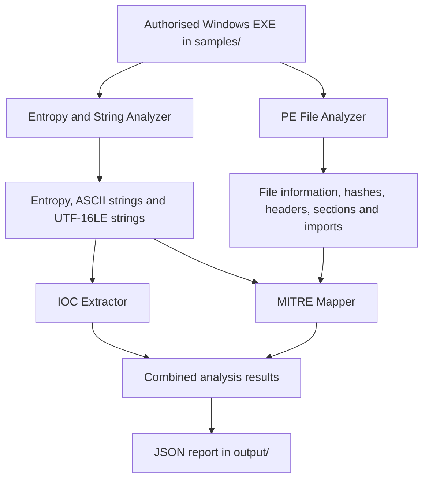

# MalTrace

**Static Binary Analyzer + MITRE ATT&CK Mapper**

MalTrace is a Python-based educational tool for performing **static analysis of Windows Portable Executable (PE) files**. It collects file metadata and hashes, examines PE headers and sections, calculates entropy, extracts readable strings and indicators, and maps selected suspicious Windows API references to candidate MITRE ATT&CK techniques.

> **Project status:** Student project / prototype. MalTrace is intended for learning and defensive analysis. Its findings are heuristic indicators that require human validation; they are not a malware verdict.

---

## Table of Contents

- [Project Overview](#project-overview)
- [Tool Information](#tool-information)
- [Key Features](#key-features)
- [Attack Categories and Lifecycle Mapping](#attack-categories-and-lifecycle-mapping)
- [How MalTrace Works](#how-maltrace-works)
- [Project Structure](#project-structure)
- [Requirements](#requirements)
- [Installation](#installation)
- [Usage](#usage)
- [Understanding the Output](#understanding-the-output)
- [Ethical Considerations](#ethical-considerations)
- [Rules of Engagement (RoE)](#rules-of-engagement-roe)
- [Responsible Disclosure](#responsible-disclosure)
- [Legal Disclaimer](#legal-disclaimer)
- [Limitations](#limitations)
- [Future Improvements](#future-improvements)
- [References](#references)

---

## Project Overview

MalTrace helps a student, analyst or security learner inspect a Windows PE executable without launching it. The tool combines several static-analysis activities into one workflow and produces a JSON report for later review.

The project focuses on the following questions:

1. What are the file's basic properties and cryptographic hashes?
2. What PE architecture, headers, sections and imported functions are present?
3. Does the file contain unusually high-entropy data or readable strings of interest?
4. Are IP addresses, URLs, domains or hash-like values present in the extracted strings?
5. Do imported or referenced Windows APIs resemble behaviours represented in MITRE ATT&CK?

MalTrace does **not** execute the selected executable. It reads the file as data for static inspection.

## Tool Information

| Item | Description |
|---|---|
| Tool name | MalTrace |
| Tool type | Static Binary Analyzer + MITRE ATT&CK Mapper |
| Main language | Python |
| Target file format | Windows PE executable (`.exe`) through the current menu workflow |
| Main library | `pefile` |
| Main framework reference | MITRE ATT&CK Enterprise |
| Analysis mode | Static analysis; no sample execution |
| Main report format | JSON |
| Intended use | Education, defensive analysis and authorised security research |

## Key Features

### 1. PE file analysis

The PE analyzer collects information from a Windows Portable Executable, including:

- File name and file size.
- MD5, SHA-1 and SHA-256 hashes.
- PE validity and basic header information.
- Architecture, subsystem, entry-point address and image base.
- Section names, virtual/raw sizes, permissions and section entropy.
- Imported DLLs and function names.
- Heuristic flags for properties such as writable-and-executable sections, unusually high entropy, UPX-like section names, non-standard section names, unusual import counts and entry-point placement.

These flags highlight properties for review. A flag does not independently establish malicious intent.

### 2. Entropy and string analysis

The string analyzer:

- Calculates Shannon entropy for the file.
- Extracts printable ASCII strings.
- Extracts printable UTF-16LE strings.
- Checks fixed-size file blocks for high-entropy regions.
- Highlights strings containing a small set of configured suspicious terms.
- Rejects string-analysis input larger than 100 MB.

High entropy can be associated with compression, encryption or packing, but legitimate files can also have high entropy.

### 3. Indicator of Compromise (IOC) extraction

The current IOC extractor searches extracted strings for:

- IPv4 and IPv6 addresses.
- HTTP and HTTPS URLs.
- Domain-like strings.
- MD5, SHA-1 and SHA-256 hash-like values.

IOC extraction is pattern-based. Results should be checked before being treated as genuine indicators. For example, a filename or DLL name containing a dot can be mistaken for a domain by a simple domain-matching rule.

### 4. Suspicious Windows API detection

The MITRE mapper checks selected Windows API names from:

- The PE import table.
- Extracted strings, which may contain API names used by dynamic resolution.

The mapping database includes API categories associated with process/memory manipulation, execution, registry and service persistence, debugger checks, process/system discovery, keyboard monitoring, credential-related access and network communication.

An imported or mentioned API is only an indicator. Static inspection cannot prove that the function is called or that it is used maliciously.

### 5. MITRE ATT&CK mapping and heuristic score

The mapper associates selected API indicators and multi-API combinations with candidate ATT&CK technique IDs, names and tactics. It also groups findings by tactic and calculates a heuristic score from 0 to 100.

The score is a project-specific prioritisation aid. It is **not** a probability that a file is malicious, a malware family identification or a substitute for analyst judgement.

### 6. JSON report generation

The main program combines the results and writes a JSON report under the `output/` directory. The report contains:

- `filename`
- `pe_analysis`
- `string_analysis`
- `ioc_analysis`
- `mitre_analysis`

---

## Attack Categories and Lifecycle Mapping

MalTrace is designed to identify **static indicators that may be associated with selected Windows attack behaviours**. The mapping below describes the categories represented by the current API rules; it is not a complete attack lifecycle and does not mean that every file exhibiting one indicator has performed that behaviour.

| Behaviour category | Example evidence checked by MalTrace | Example ATT&CK mapping in the current rules |
|---|---|---|
| Execution | Process creation and shell/file-operation API references | T1106 – Native API; T1059 – Command and Scripting Interpreter (candidate mapping; context must be reviewed) |
| Process injection / memory manipulation | APIs such as `VirtualAllocEx`, `WriteProcessMemory`, `CreateRemoteThread` and `QueueUserAPC` | T1055 – Process Injection; T1055.004 – Asynchronous Procedure Call; T1055.012 – Process Hollowing |
| Persistence | Registry and Windows service API references | T1547.001 – Registry Run Keys / Startup Folder; T1543.003 – Windows Service |
| Anti-analysis / debugger evasion | Debugger-checking API references | T1622 – Debugger Evasion |
| Dynamic API resolution | `LoadLibrary` and `GetProcAddress` references | T1027.007 – Dynamic API Resolution |
| Discovery | Process enumeration and system information API references | T1057 – Process Discovery; T1082 – System Information Discovery |
| Collection / credential-related access | Keyboard-hook and DPAPI-related API references | T1056.001 – Keylogging; T1555 – Credentials from Password Stores |
| Network communication / transfer | WinINet, Winsock and URL-download API references | T1071.001 – Web Protocols; T1105 – Ingress Tool Transfer |

**Mapping caution:** API-to-technique relationships are contextual. For example, generic registry APIs do not prove that a Run key was modified, and a process-creation API is common in legitimate software. Review each mapping against the current [MITRE ATT&CK Enterprise Matrix](https://attack.mitre.org/matrices/) before using it in an assessment or report. MITRE describes tactics as adversary goals and techniques as ways of achieving those goals; ATT&CK is not a guaranteed chronological sequence.

## How MalTrace Works

The diagram below shows the program's analysis workflow.



### Processing stages

1. **Input selection:** The current `main.py` lists `.exe` files found directly inside `samples/` and asks the user to select one.
2. **PE inspection:** The PE analyzer checks and parses the executable, calculates hashes, and extracts PE metadata, sections, imports and heuristic flags.
3. **Entropy and strings:** The string analyzer calculates entropy and extracts ASCII and UTF-16LE strings.
4. **IOC extraction:** The IOC module checks the extracted strings for supported indicator patterns.
5. **ATT&CK mapping:** The MITRE mapper checks imported API names and extracted strings against its local API rule database, then evaluates configured API combinations.
6. **Report creation:** `main.py` combines the module results and writes a JSON file to `output/`.

---

## Project Structure

The repository is organised as follows (some local folders may contain runtime files that are intentionally not committed):

```text
MalTrace/
├── main.py                  # Main program and module integration
├── guardrails.py            # Reusable ethical/scope guardrail helpers
├── inspect_report.py        # Helper script for inspecting a saved JSON report
├── README.md                # Project documentation
├── modules/
│   ├── __init__.py
│   ├── pe_analyzer.py       # PE metadata, sections, imports and hashes
│   ├── string_analyzer.py   # Entropy and readable string extraction
│   ├── ioc_extractor.py     # IP, URL, domain and hash extraction
│   └── mitre_mapper.py      # Suspicious API and ATT&CK mapping
├── samples/
│   └── README.md            # Instructions for local test samples
└── output/                  # Generated JSON reports (local use)
```

Do not commit executable test samples or sensitive analysis output to this public repository.

## Requirements

- Windows 10/11 recommended for the project's Windows PE test workflow.
- Python 3.8 or later recommended.
- Internet access only for downloading Python and the `pefile` dependency; MalTrace's file analysis does not require a network connection.
- The `pefile` Python package.

The code currently imports Python standard-library modules for hashing, regular expressions, entropy, IP parsing, URL parsing, JSON and file handling. PE parsing uses `pefile`.

## Installation

### 1. Clone the repository

Open PowerShell, Command Prompt or a terminal in VS Code:

```powershell
git clone https://github.com/Rydersnake/MalTrace.git
cd MalTrace
```

### 2. Install the dependency

```powershell
python -m pip install pefile
```

Confirm that Python and `pefile` are available:

```powershell
python --version
python -m pip show pefile
```

### 3. Prepare the folders

Ensure the repository contains `samples/` and `output/`. Put only authorised test executables in the local `samples/` folder. Keep the test binaries on your computer; do not upload them to the public repository.

---

## Usage

### 1. Add an authorised test file

Place a Windows `.exe` file that you own or have written permission to analyse inside:

```text
MalTrace/samples/
```

For an initial safe demonstration, use a legitimate Windows executable such as a local copy of Notepad. Copy it into `samples/`; do not execute an unknown or suspicious sample.

### 2. Run MalTrace

From the repository's root directory:

```powershell
python main.py
```

### 3. Select a file

The current program displays the `.exe` files in `samples/`. Enter the number beside the file you want to analyse.

Example interaction (illustrative):

```text
========================================
             MALTRACE
    Static Binary Analyzer
     MITRE ATT&CK Mapper
========================================

Available files:
1. notepad.exe

Select a file to analyse: 1

[1] PE FILE ANALYSIS
File information and hashes collected.

[2] ENTROPY AND STRING ANALYSIS
Entropy: <calculated value>
Verdict: <calculated verdict>

[3] IOC EXTRACTION
ips: <count> found
urls: <count> found
domains: <count> found
hashes: <count> found

[4] MITRE ATT&CK ANALYSIS
Suspicious APIs: <count>
MITRE Risk Score: <score> /100
MITRE Risk Level: <level>

ANALYSIS COMPLETED
Report saved at: output/notepad_report.json
```

The values depend on the selected executable. A legitimate program can contain API references or strings that trigger heuristic findings; review the JSON report rather than treating the score as a verdict.

### 4. Locate the report

After analysis, open:

```text
MalTrace/output/
```

The current naming format is:

```text
<file-name-without-extension>_report.json
```

For example, analysing `notepad.exe` creates `output/notepad_report.json`.

---

## Ethical Considerations

MalTrace is intended for defensive, educational and authorised static analysis. The project follows these principles:

- **Authorisation first:** Analyse only files that you own or for which you have explicit permission from the owner.
- **Defined scope:** Use the project's `samples/` directory for authorised `.exe` test files. Do not use MalTrace to inspect files outside the agreed assessment scope.
- **Static analysis only:** The tool reads file bytes and PE structures. It does not need to execute the sample.
- **Safe handling:** Treat unknown executables as potentially harmful. Do not double-click or run them. Use an isolated, appropriately configured virtual machine for handling suspicious samples.
- **Data minimisation:** Reports can contain file paths, domains, URLs, email-like strings or other information extracted from a binary. Review and sanitise reports before sharing them.
- **No public malware uploads:** Do not commit malware, confidential binaries, personal data or sensitive IOCs to this public GitHub repository.
- **Honest interpretation:** Findings and ATT&CK mappings are leads for investigation, not proof of compromise or malicious behaviour.

### Implementation status of safety controls

The repository contains `guardrails.py`, which defines helper functions for a legal disclaimer and authorisation prompt, restricting input to `.exe` files under `samples/`, restricting output to a project directory, dry-run argument handling and a Ctrl+C kill-switch wrapper.

**Important implementation note:** The current `main.py` does not import or call these `guardrails.py` helpers. Therefore, the interactive workflow documented above should not be described as enforcing the disclaimer prompt, full path validation, dry-run mode or the custom kill switch until those helpers are integrated and tested. Users must follow the Rules of Engagement below regardless.

---

## Rules of Engagement (RoE)

The following rules apply to all MalTrace use, demonstrations and project testing:

1. **Written permission:** Obtain permission from the owner or responsible administrator before analysing a file that is not yours.
2. **Scope definition:** Identify the exact executable(s), storage location, purpose and time period covered by the authorisation.
3. **Permitted activity:** Perform static inspection only. Do not execute samples, attempt unauthorised access, alter systems, establish persistence, communicate with suspicious infrastructure or conduct network testing as part of this tool's workflow.
4. **Approved environment:** Use benign test executables for demonstrations. Handle unknown or malicious samples only in a controlled, isolated environment with appropriate containment.
5. **Evidence handling:** Record the file name, source, date received and cryptographic hashes where appropriate. Keep original samples unchanged.
6. **Output protection:** Store reports in the local `output/` folder, restrict access where they contain sensitive information, and sanitise them before sharing.
7. **Stop condition:** Stop analysis if the file is outside scope, authorisation is unclear, the sample may affect a live system, or unexpected behaviour occurs. Do not run the sample to investigate it.
8. **Reporting:** Share findings only with the authorised owner, instructor or designated security contact.

These RoE are operating requirements for the project. They do not replace the technical integration of the helper controls in `guardrails.py`.

## Responsible Disclosure

If MalTrace identifies a suspected vulnerability in software or a system:

1. Do not exploit the issue beyond the minimum activity needed to validate it within the authorised scope.
2. Do not access, modify, copy or disclose another party's data.
3. Preserve relevant evidence safely, such as timestamps, hashes, versions and minimal reproduction details. Remove credentials, personal information and unrelated data.
4. Notify the affected software owner or their designated security team privately.
5. Give the owner a reasonable opportunity to investigate and remediate before any public disclosure.
6. Do not publish exploit code, confidential reports or live malicious samples in this public repository.

For vulnerabilities in MalTrace itself, report them privately to the project maintainers through an agreed private communication channel rather than posting sensitive details in a public issue.

## Legal Disclaimer

MalTrace is provided for educational, research and defensive security purposes only. The user is responsible for ensuring that every analysis is authorised and complies with all applicable laws, regulations, contracts, organisational policies and institutional rules.

In Malaysia, users should be aware of the **Computer Crimes Act 1997 (Act 563)**, including provisions relating to unauthorised access to computer material and unauthorised modification of computer contents. This README is not legal advice and does not determine whether a particular activity is lawful. Obtain appropriate legal or institutional guidance where necessary.

The authors and contributors provide MalTrace on an educational, prototype basis and make no guarantee that it will detect all malicious files, identify all relevant ATT&CK techniques, or produce error-free results. Users are responsible for decisions made using its output.

---

## Limitations

MalTrace has the following limitations:

- **Static analysis only:** It does not execute files or observe runtime behaviour, process activity, memory activity or live network traffic.
- **Windows PE focus:** The current `main.py` menu selects `.exe` files. It is not a general analyser for scripts, documents, APKs, Linux ELF files or macOS Mach-O files.
- **API imports are not execution evidence:** An imported API may be unused, used for a legitimate purpose or referenced by a library. A string match may be inert text.
- **Limited ATT&CK coverage:** The local API database is a curated subset, not the complete MITRE ATT&CK knowledge base. Mappings may be incomplete or need updating as ATT&CK changes.
- **Heuristic attack-chain detection:** The presence of multiple API names does not prove that the APIs execute together or in a particular sequence.
- **Heuristic score:** The 0–100 risk score is not a calibrated probability, antivirus verdict or formal risk rating.
- **Entropy ambiguity:** High entropy can indicate compression, encryption or packing, but can also occur in legitimate data. Low entropy does not establish that a file is safe.
- **IOC false positives and false negatives:** Pattern-based extraction can miss obfuscated or encoded values and can incorrectly identify filenames, library names or version strings as domains.
- **String coverage:** ASCII and UTF-16LE extraction does not recover all encodings, compressed content, encrypted content or dynamically generated strings.
- **File-size handling:** The string analyzer refuses files larger than 100 MB. Other analysis modules may have separate resource requirements.
- **No reputation service:** The current workflow does not query VirusTotal or another external reputation database.
- **No sandbox or dynamic analysis:** MalTrace is not a replacement for a malware sandbox, endpoint protection, antivirus or incident-response platform.
- **Safety-helper integration:** The `guardrails.py` helper functions are not currently connected to `main.py`; see [Implementation status of safety controls](#implementation-status-of-safety-controls).

A result of “no indicators detected” does not mean that a file is safe. A high score does not prove that a file is malicious. Always validate important findings using additional evidence and trusted security tools.

## Future Improvements

Potential future work includes:

- Integrating and testing the `guardrails.py` authorisation, scope, output and interruption controls in the main workflow.
- Improving domain and URL validation to reduce false positives.
- Reviewing all API-to-ATT&CK mappings against the current ATT&CK knowledge base.
- Separating generic API references from stronger behavioural evidence.
- Improving risk-score calibration and explaining each score contribution in the report.
- Adding report export formats such as HTML, if required by the project scope.
- Adding regression tests using benign PE files and controlled test fixtures.
- Improving error handling for malformed, truncated or unusually large PE files.

## References

- [MITRE ATT&CK Enterprise Matrix](https://attack.mitre.org/matrices/)
- [MITRE ATT&CK Enterprise Tactics](https://attack.mitre.org/tactics/enterprise/)
- [MITRE ATT&CK – Get Started](https://attack.mitre.org/resources/enterprise-introduction/)
- [pefile on PyPI](https://pypi.org/project/pefile/)
- [Malaysia Computer Crimes Act 1997 (Act 563) – Attorney General's Chambers legislation record](https://lom.agc.gov.my/act-detail.php?act=563&lang=BI)

---

**MalTrace — Static analysis for learning and defensive investigation. Analyse responsibly.**
