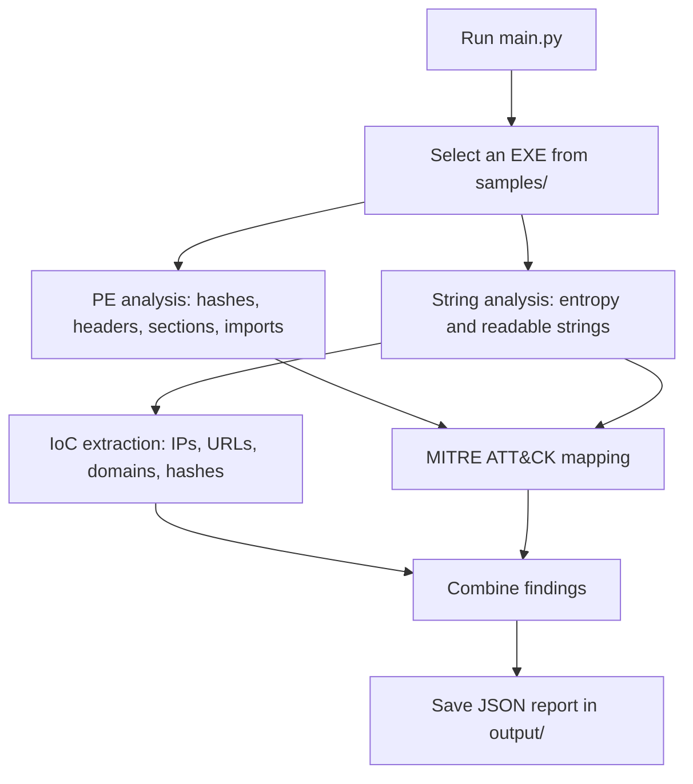

# MalTrace

**Static Binary Analyzer & MITRE ATT&CK Mapper**

MalTrace is a Python command-line tool for the static inspection of Windows Portable Executable (PE) files. It collects file hashes and PE metadata, analyses entropy, extracts readable strings and selected indicators of compromise (IoCs), and maps selected Windows API indicators to MITRE ATT&CK techniques. Results are combined into a JSON report for review.

MalTrace is an educational defensive-security project. It reads files as data and is not designed to execute samples. Its findings are indicators for further investigation, not proof that a file is malicious or safe.

> **Safety first:** Analyse only files you own or are explicitly authorised to examine. Do not run unknown samples. Keep samples and reports private; never upload real malware or sensitive investigation material to this public repository.

## At a glance

| Item | Details |
|---|---|
| Tool | MalTrace |
| Category | Defensive cybersecurity – malware static analysis |
| Input | Windows `.exe` files in the local `samples/` directory |
| Main entry point | `main.py` |
| Output | JSON report in `output/` |
| Main dependency | Python 3 and `pefile` |

## Attack category and scope

MalTrace supports introductory analysis of Windows malware-related artefacts. It looks for static clues associated with:

- Process injection and process hollowing
- Registry and service-related persistence
- Debugger evasion and dynamic API resolution
- Process and system discovery
- Credential-access and input-capture indicators
- Network communication and tool-transfer indicators

The tool does **not** execute malware, monitor runtime behaviour, capture network traffic, or provide complete incident-response or sandbox capabilities.

## Features

| Module | Main functions |
|---|---|
| `pe_analyzer.py` | Calculates MD5/SHA-1/SHA-256; checks PE format; extracts selected headers, architecture, sections, imports and heuristic flags. |
| `string_analyzer.py` | Calculates Shannon entropy; extracts ASCII and UTF-16LE strings; identifies high-entropy regions and selected suspicious strings. |
| `ioc_extractor.py` | Extracts IPv4 addresses, HTTP/HTTPS URLs, domain candidates and hash-shaped strings from extracted text. |
| `mitre_mapper.py` | Matches selected API names from PE imports and strings; groups findings by tactic; checks configured API combinations; calculates a heuristic score. |
| `main.py` | Provides the interactive file-selection workflow, combines module results and saves a JSON report. |

The string-analysis module applies a 100 MB input-size limit. IoC matches and API matches require review; a match is not automatically a confirmed malicious indicator.

## Analysis workflow



### MITRE ATT&CK lifecycle mapping

The mapper uses a **selected local subset** of MITRE ATT&CK Enterprise techniques. The examples below describe the areas represented in the rules; coverage is not comprehensive.

| Tactic / behaviour area | Example techniques | Static evidence considered |
|---|---|---|
| Execution | Native API (`T1106`); Command and Scripting Interpreter (`T1059`) | Selected process-creation or execution-related API indicators |
| Persistence | Registry Run Keys / Startup Folder (`T1547.001`); Windows Service (`T1543.003`) | Selected registry- and service-related indicators |
| Defense Evasion | Process Injection (`T1055`); Process Hollowing (`T1055.012`); Debugger Evasion (`T1622`) | Memory-manipulation and debugger-check API indicators |
| Stealth / dynamic API resolution | Dynamic API Resolution (`T1027.007`) | `LoadLibrary` and `GetProcAddress`-style indicators |
| Credential Access / Collection | Credentials from Password Stores (`T1555`); Keylogging (`T1056.001`) | Selected credential and keyboard-hook API indicators |
| Discovery | Process Discovery (`T1057`); System Information Discovery (`T1082`) | Process-enumeration and system-information API indicators |
| Command and Control / transfer | Web Protocols (`T1071.001`); Ingress Tool Transfer (`T1105`) | Selected networking and download API indicators |

ATT&CK matches are hypotheses based on static indicators. An imported or referenced API does not prove it was called, and an API combination does not prove that a behaviour occurred in sequence. Verify technique IDs and tactic assignments against the [MITRE ATT&CK knowledge base](https://attack.mitre.org/) before relying on them in a formal assessment.

## Repository structure

```text
MalTrace/
├── main.py                 # Interactive workflow and JSON reporting
├── guardrails.py           # Ethical/scope helper functions
├── inspect_report.py      # Local JSON report inspection helper
├── README.md
├── modules/
│   ├── __init__.py
│   ├── pe_analyzer.py
│   ├── string_analyzer.py
│   ├── ioc_extractor.py
│   └── mitre_mapper.py
├── samples/                # Place authorised test EXEs here locally
└── output/                 # Generated JSON reports
```

Do not commit test binaries, real malware, private samples or sensitive reports to the public repository.

## Installation

**Requirements:** Windows, Python 3, Git (or a ZIP download), and the `pefile` package.

1. Clone the project and enter its directory:

   ```bash
   git clone https://github.com/Rydersnake/MalTrace.git
   cd MalTrace
   ```

   Alternatively, download the repository ZIP from GitHub and extract it.

2. Install the PE parsing dependency:

   ```powershell
   py -m pip install pefile
   ```

   If `py` is unavailable, use `python -m pip install pefile`.

3. Place an authorised, benign Windows `.exe` test file in the local `samples/` directory. Do not upload the executable to GitHub.

## Usage

Run the program from the project root:

```powershell
py main.py
```

Or:

```powershell
python main.py
```

MalTrace lists `.exe` files in `samples/`. Select a file by entering its number:

```text
========================================
             MALTRACE
      Static Binary Analyzer
       MITRE ATT&CK Mapper
========================================

Available files:
1. sample.exe

Select a file to analyse:
```

After selection, the tool performs PE analysis, entropy and string analysis, IoC extraction, and MITRE ATT&CK mapping. The combined report is saved as:

```text
output/sample_report.json
```

Open the JSON file in VS Code or another text editor to review the results. The report contains `pe_analysis`, `string_analysis`, `ioc_analysis` and `mitre_analysis` sections.

The optional `inspect_report.py` helper currently reads `output/notepad_report.json`. Edit its `report_path` value before using it with a differently named report, then run:

```powershell
py inspect_report.py
```

## Understanding results

- **Hashes** identify the exact file contents; they do not establish whether a file is malicious.
- **Entropy** can indicate compression, encryption or packing, but legitimate files can also have high entropy.
- **IoCs** are extracted candidates and may include false positives or benign values.
- **API matches** show that an API name was imported or found in strings; they do not show that it executed.
- **MITRE score and level** are heuristic outputs from local rules, not a malware probability or validated severity rating.

Review the underlying evidence and corroborate findings with trusted sources and appropriate analysis tools. A low score does not prove a file is safe; a high score does not prove it is malicious.

## Ethical considerations

MalTrace must be used only for education, defensive analysis and other explicitly authorised purposes.

1. **Authorisation:** Obtain permission from the file owner, lecturer, supervisor or organisation before analysing non-public files.
2. **Defined scope:** Analyse only approved files placed in the local `samples/` directory. Do not use extracted indicators to probe third-party systems.
3. **Static-only handling:** MalTrace is intended to read file data; do not execute or detonate samples during this workflow.
4. **Safe environment:** Treat unknown files as potentially harmful. Use an isolated, appropriately configured analysis VM where necessary.
5. **Privacy:** Keep samples and reports local. Do not publish credentials, personal data, internal paths, private indicators or confidential findings.
6. **Accurate reporting:** Describe results as indicators requiring validation, not definitive malware verdicts.

### Rules of Engagement (RoE)

Before analysis, agree and document the following:

- **Permission and purpose:** Identify who authorised the work, why the sample is being analysed, and who may access the results.
- **Scope:** Limit input to approved Windows `.exe` files in the local `samples/` directory. No network, website, cloud or third-party infrastructure scanning is authorised by this project.
- **Permitted actions:** Read the file, calculate hashes and entropy, extract strings and candidate IoCs, inspect PE metadata/imports, apply local ATT&CK rules, and save a local JSON report.
- **Prohibited actions:** Do not execute samples, attempt access to external systems, deploy extracted code, evade security controls, collect credentials, or redistribute malware.
- **Stop conditions:** Stop if authorisation is unclear or withdrawn, the sample is out of scope, sensitive information is exposed, or the environment behaves unexpectedly.
- **Evidence handling:** Preserve the original sample; record its SHA-256 hash and keep reports in approved storage.

**Implementation note:** `guardrails.py` contains helper functions for consent, path restrictions, output checks, dry-run handling and interruption handling. In the current implementation, `main.py` does not import or invoke these helpers. Therefore, those checks are not automatically enforced by running `main.py`; users must follow the RoE manually until the helpers are integrated and tested.

### Responsible disclosure

If analysis suggests a concern involving a real organisation, product or third-party environment:

1. Do not access or test the suspected system based only on an extracted indicator.
2. Preserve only the minimum evidence needed, such as the sample hash and relevant static findings.
3. Do not publish personal data, credentials, private infrastructure details or unverified allegations.
4. Report the concern privately to the organisation's security contact, vendor security team or an appropriate incident-response channel.
5. Follow the recipient's coordinated disclosure process and share information only when authorised.

MalTrace does not submit findings to external organisations or services. Disclosure is a human-led process.

### Legal disclaimer

MalTrace is provided for educational and authorised defensive-security purposes only. Users are responsible for complying with all applicable laws, regulations, institutional policies, contracts and permission requirements. Nothing in this README is legal advice. The project authors do not authorise unlawful use. The software and its findings are provided on a best-effort basis without a guarantee of accuracy, completeness or suitability for a particular decision. Users are responsible for how they use the tool and handle analysed files.

## Limitations

- The interactive workflow is focused on Windows `.exe` PE files; it is not a general analyser for ELF, Mach-O, scripts or documents.
- Static analysis cannot observe runtime behaviour, memory activity, network traffic or actual API execution.
- ATT&CK coverage is limited to the techniques represented in the local rule database.
- API, string, entropy and IoC heuristics can produce false positives and false negatives.
- Packing, obfuscation, encryption and unusual PE structures may hide relevant information.
- The main workflow reports IPv4 addresses, URLs, domain candidates and hash-shaped strings; other IoC types may not be included in the combined report.
- The string analyser refuses files larger than 100 MB.
- MalTrace does not query external reputation services or threat-intelligence feeds.
- The current main program generates JSON reports; it does not automatically create HTML or PDF reports.
- The `guardrails.py` helpers are not yet connected to `main.py` (see the implementation note above).

## Troubleshooting

| Problem | Suggested action |
|---|---|
| `ModuleNotFoundError: pefile` | Run `py -m pip install pefile`. |
| No EXE files found | Confirm `samples/` exists and contains an authorised `.exe`; run from the project root. |
| Invalid PE file | Check that the file is a valid, supported Windows executable and is not damaged. |
| No report appears | Check that analysis completed and that the project `output/` directory is writable. |

## References

- [MalTrace repository](https://github.com/Rydersnake/MalTrace)
- [MITRE ATT&CK Enterprise](https://attack.mitre.org/)
- [Python documentation](https://docs.python.org/3/)
- [pefile on PyPI](https://pypi.org/project/pefile/)

---

**Project status:** MalTrace is an academic prototype. Review the code, test the analysis rules and integrate the ethical guardrails before using it beyond a controlled educational exercise.
